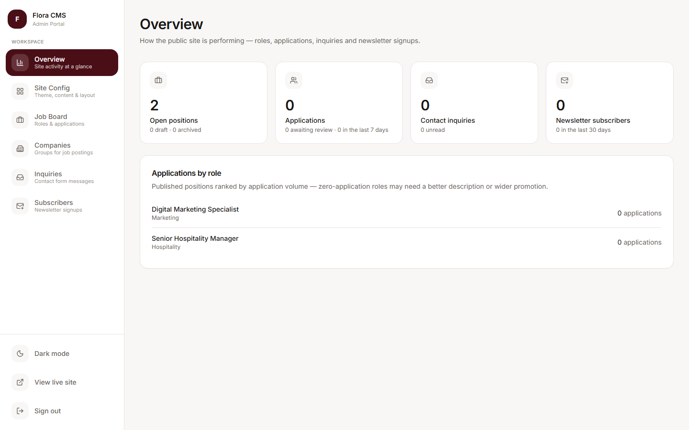
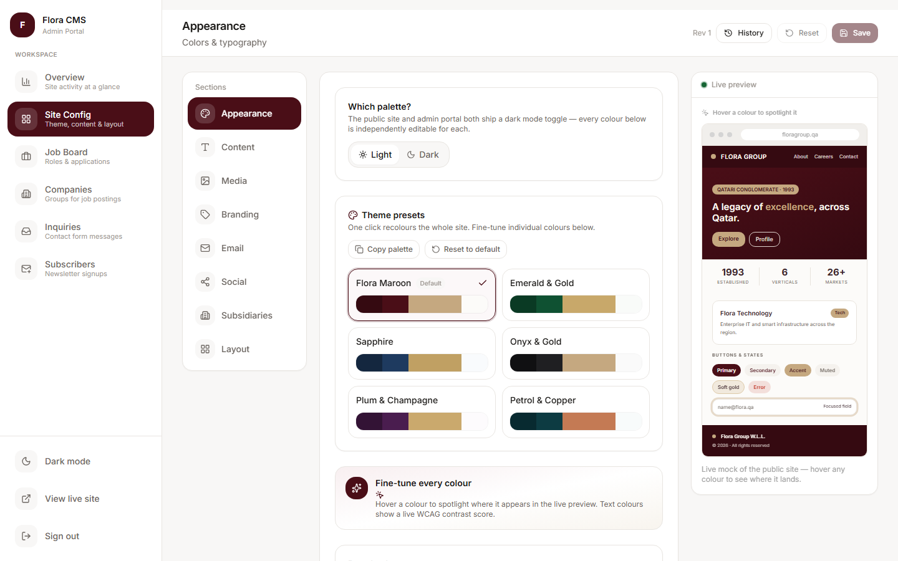

# Flora CMS — Admin Portal




A standalone Next.js 16 app for managing the public Flora Group website's theme,
branding, and homepage layout. Part of a 3-part ecosystem: [flora-backend](https://github.com/Jawabreh2k/flora-backend) (.NET 9 API), [flora-group-website](https://github.com/Jawabreh2k/flora-group-website) (public site) and this portal.

## Architecture — Backend-for-Frontend (BFF)

The browser **never** holds the JWT or talks to the .NET API directly. Instead:

```
Browser ──> Admin Portal route handlers ──(Bearer JWT)──> .NET CMS API
              │  (JWT in httpOnly cookie)
              └──(x-revalidate-secret)──> Public site /api/revalidate
```

- **`POST /api/session`** — exchanges credentials for a JWT (via the API's
  `/api/auth/login`) and stores it in an **httpOnly, SameSite=Lax** cookie. Mitigates
  XSS token theft.
- **`DELETE /api/session`** — logout (clears the cookie).
- **`PUT /api/config`** — forwards the edited payload to the API's protected
  `PUT /api/admin/ui/config` with the cookie's Bearer token, then calls the public
  site's revalidation webhook so changes go live **instantly**.
- **`middleware.ts`** — gates `/dashboard` on cookie presence (real authorization is
  enforced by the API's JWT validation).

## Features

- 📊 Overview dashboard with real business stats
- 💼 Jobs: create/edit, with Arabic fields
- 🏢 Companies and subsidiaries: create, edit, hide from the public site
- 📥 Contact inquiries and newsletter subscribers (CSV export)
- 🌗 Dark-mode controls
- 🔐 JWT login (httpOnly cookie session)
- 🎨 Grouped colour-token editor (swatch + free-text, supports hex/oklch/rgb)
- 🔤 Radius + font controls
- 🧩 Homepage section toggles (stats / subsidiaries / spotlight)
- 🖼️ Live preview using the **same CSS-variable mapping** as the public site
- 💾 Save & publish → writes to SQL Server JSON column + instant site revalidation

## Run

Requires the .NET API (Step 1) and ideally the public site (Step 2) running.

```bash
pnpm install
pnpm dev          # http://localhost:3001
```

Copy `.env.example` → `.env.local` and set values. The `FLORA_REVALIDATE_SECRET`
must match the public site's secret for instant publishing to work.

Default dev login (from the API seed): `admin` / `ChangeMe!2026`.

## Ports

| App | Port |
| --- | --- |
| Public site | 3000 |
| Admin Portal | 3001 |
| .NET CMS API | 5253 |
